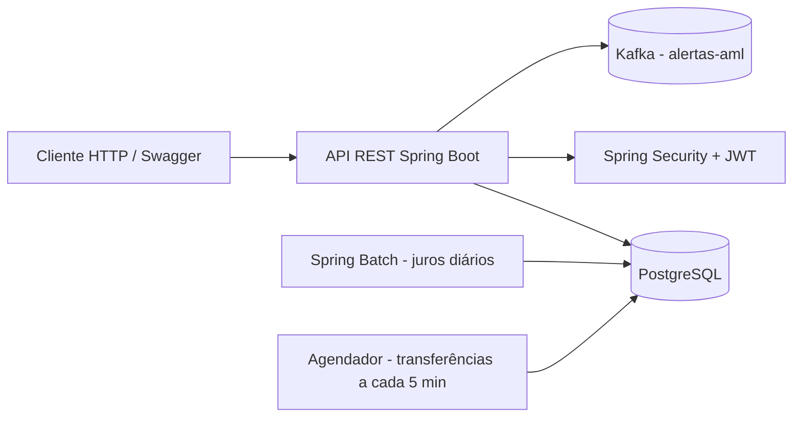

# 🏦 Sistema Bancário


API REST para um sistema bancário simplificado, com contas corrente e poupança,
transferências, agendamentos, prevenção a fraudes, alertas AML publicados no Kafka
e aplicação de juros em lote com Spring Batch.

> Projeto desenvolvido para fins de estudo. **Não use em produção sem revisar
> autenticação, autorização, criptografia, auditoria e infraestrutura.**

---

## 📋 Índice

- [Visão geral](#-visão-geral)
- [Funcionalidades](#-funcionalidades)
- [Stack tecnológico](#-stack-tecnológico)
- [Pré-requisitos](#-pré-requisitos)
- [Configuração](#-configuração)
- [Banco de dados](#-banco-de-dados)
- [Executando o projeto](#-executando-o-projeto)
- [Autenticação e perfis](#-autenticação-e-perfis)
- [Endpoints](#-endpoints)
- [Regras de negócio](#-regras-de-negócio)
- [Enums](#-enums)
- [DTOs](#-dtos)
- [Exemplos de uso](#-exemplos-de-uso)
- [Tratamento de erros](#-tratamento-de-erros)
- [Testes](#-testes)
- [Estrutura do projeto](#-estrutura-do-projeto)
- [Limitações e cuidados](#-limitações-e-cuidados)
- [Contribuindo](#-contribuindo)
- [Autor](#-autor)

---

## 🔎 Visão geral

O sistema expõe uma API REST protegida por JWT para gerenciar:

- usuários e seus perfis (`ADMIN`, `GERENTE`, `CLIENTE`);
- contas corrente e poupança;
- depósitos, saques e transferências;
- transferências agendadas;
- extrato e transações pendentes;
- alertas de prevenção à lavagem de dinheiro (AML);
- aplicação diária de juros em contas poupança.

### Arquitetura



### Fluxo resumido

1. Se `ADMIN_PASSWORD` estiver definida (mínimo 12 caracteres), a aplicação cria um usuário `ADMIN` na primeira inicialização. Sem ela, nenhum admin é criado. `ADMIN_USERNAME` e `ADMIN_EMAIL` têm valores padrão.
2. O cliente faz login em `POST /auth/signin` e recebe `token` e `refreshToken`.
3. O token é enviado no cabeçalho `Authorization: Bearer <token>`.
4. As rotas são liberadas conforme o perfil do usuário.
5. Depósitos, saques e transferências geram transações e podem gerar alertas AML.

---

## ✨ Funcionalidades

### Usuários
- Cadastro com `username` e `email` únicos.
- Senha criptografada com BCrypt.
- Atualização de dados, troca de perfil, ativação e desativação.
- Perfis `ADMIN`, `GERENTE` e `CLIENTE`.
- Criação do usuário `ADMIN` via variáveis de ambiente (`ADMIN_USERNAME`, `ADMIN_EMAIL`, `ADMIN_PASSWORD`).

### Contas
- Conta poupança (`SavingsAccount`) e conta corrente (`CheckingAccount`).
- Validação de CPF, e-mail, telefone, documento e data de nascimento.
- Saldo inicial mínimo de **R$ 100,00**.
- Vínculo obrigatório com um usuário ativo.
- Ativação e desativação de contas.
- Consulta de saldo e extrato.

### Movimentações
- Depósito em conta poupança e corrente.
- Saque com limite acumulado de **R$ 2.000,00 em 24 horas**.
- Transferência entre contas corrente e poupança.
- Transferência direta entre contas do mesmo tipo.
- Transferência agendada entre contas poupança.
- Reprocessamento e cancelamento de agendamentos.

### Segurança e antifraude
- Autenticação stateless com JWT.
- Access token e refresh token.
- Autorização por perfil.
- Detecção de depósitos repetidos, recorrentes e de alto valor.
- Registro de alertas AML no banco.
- Publicação de alertas no tópico Kafka `alertas-aml`.
- Validação de horário para TED e DOC.
- Validação de feriados nacionais e fins de semana.

### Processamento em lote
- Job Spring Batch `interestCalculationJob`.
- Execução diária às **23h59**.
- Aplicação de juros em todas as contas poupança.
- Processamento em chunks de 50 contas.

---

## 🛠 Stack tecnológico

| Camada | Tecnologia |
|--------|------------|
| Linguagem | Java 17 |
| Framework | Spring Boot 3.4.3 |
| Web | Spring Web (REST) |
| Persistência | Spring Data JPA + Hibernate |
| Banco | PostgreSQL |
| Segurança | Spring Security + JWT (jjwt 0.11.5) |
| Validação | Jakarta Validation + Hibernate Validator |
| Mensageria | Spring Kafka |
| Processamento em lote | Spring Batch + Scheduling |
| Documentação da API | Springdoc OpenAPI 2.8.5 (Swagger UI) |
| Mapeamento | MapStruct 1.6.3 + Lombok |
| Migrations | Flyway 10.20.1 |
| Testes | JUnit 5, Mockito, Spring Security Test e Testcontainers (PostgreSQL 16.3) |
| Build | Maven Wrapper (`./mvnw`) |
| CI | GitHub Actions |
| Infra local | Docker Compose (Kafka) |

---

## ✅ Pré-requisitos

- **JDK 17** ou superior
- **Maven 3.8+** (ou use o wrapper `./mvnw`)
- **PostgreSQL** em execução
- **Kafka** (necessário para publicar alertas AML)
- **Docker** (necessário para os testes de integração com Testcontainers; opcional para subir o Kafka)
- **Docker Compose** (opcional, para subir o Kafka)

Verifique as versões:

```bash
java -version
./mvnw -version
```

---

## ⚙️ Configuração

O arquivo `src/main/resources/application.yml` contém dados locais e **não é
versionado** (está no `.gitignore`). O modelo seguro fica em
`src/main/resources/application.yml.example`.

### 1. Crie seu arquivo local

```bash
cp src/main/resources/application.yml.example src/main/resources/application.yml
```

### 2. Preencha as variáveis

Você pode editar o `application.yml` ou usar variáveis de ambiente:

```bash
export DB_URL="jdbc:postgresql://localhost:5555/Banking_systemDB"
export DB_USERNAME="postgres"
export DB_PASSWORD="sua-senha"
export JWT_SECRET="$(openssl rand -base64 32)"
export ADMIN_USERNAME="admin"
export ADMIN_EMAIL="admin@example.com"
export ADMIN_PASSWORD="uma-senha-forte"
```

O modelo usado pelo projeto:

```yaml
spring:
  datasource:
    url: ${DB_URL:jdbc:postgresql://localhost:5555/Banking_systemDB}
    username: ${DB_USERNAME:postgres}
    password: ${DB_PASSWORD:SUA_SENHA_AQUI}

  flyway:
    enabled: true
    locations: classpath:db/migration

  jpa:
    hibernate:
      ddl-auto: none

  batch:
    jdbc:
      initialize-schema: never
      table-prefix: batch.BATCH_

  kafka:
    bootstrap-servers: localhost:9092

jwt:
  secret: ${JWT_SECRET:COLOQUE_UMA_CHAVE_BASE64_DE_32_BYTES_AQUI}
```

> 🔐 Gere o segredo JWT com `openssl rand -base64 32`. Nunca faça commit do
> `application.yml` real, de senhas ou de chaves.

### 3. Usuário administrador

O admin **não é mais criado com senha fixa no código**. A aplicação cria um
usuário `ADMIN` somente quando `ADMIN_PASSWORD` está definida (mínimo de 12
caracteres). Sem ela, nenhum admin é criado.

| Campo | Origem |
|-------|--------|
| Username | `ADMIN_USERNAME` (padrão: `admin`) |
| E-mail | `ADMIN_EMAIL` (padrão: `admin@exemplo.com`) |
| Senha | `ADMIN_PASSWORD` (obrigatória, armazenada com BCrypt) |
| Perfil | `ADMIN` |

A senha nunca aparece no código-fonte nem no Git.

---

## 🗄 Banco de dados

O schema é gerenciado pelo **Flyway**. As migrations ficam em
`src/main/resources/db/migration/` e são aplicadas automaticamente na
inicialização da aplicação.

| Versão | Migration | Conteúdo |
|--------|-----------|----------|
| V1 | `V1__create_users.sql` | Tabela `users` |
| V2 | `V2__create_accounts.sql` | Tabelas `savings_account` e `checking_account` |
| V3 | `V3__create_transaction.sql` | Tabela `transaction` |
| V4 | `V4__create_alert_aml.sql` | Tabela `alert_aml` |
| V5 | `V5__create_scheduled_transfer.sql` | Tabela `scheduled_transfer` |
| V6 | `V6__add_user_account_foreign_keys.sql` | FKs inversas de `users` para as contas |
| V7 | `V7__create_batch_tables.sql` | Schema `batch` e tabelas do Spring Batch |

Configuração usada:

```yaml
spring:
  flyway:
    enabled: true
    locations: classpath:db/migration
  jpa:
    hibernate:
      ddl-auto: none
  batch:
    jdbc:
      initialize-schema: never
```

Para um banco novo, crie apenas o database vazio e inicie a aplicação; o Flyway
aplica as migrations na ordem.

> ⚠️ Se o banco já possui tabelas criadas manualmente e **não** tem a tabela de
> histórico do Flyway (`flyway_schema_history`), recrie o database vazio antes de
> subir a aplicação. Alternativamente, configure `baseline-on-migrate` com
> cuidado. Não edite migrations já aplicadas: crie uma nova versão.

---

## 🚀 Executando o projeto

### 1. Clone o repositório

```bash
git clone https://github.com/Kiraruto/Sistema-Bancario.git
cd Sistema-Bancario
git checkout 1.5.0
```

### 2. Suba o Kafka (opcional, mas recomendado)

O `docker-compose.yml` fica em `src/main/resources/`:

```bash
docker network create bank-network
docker compose -f src/main/resources/docker-compose.yml up -d
```

### 3. Compile e execute

```bash
./mvnw clean package
./mvnw spring-boot:run
```

Ou execute o JAR gerado:

```bash
java -jar target/Sistema-bancario-0.0.1-SNAPSHOT.jar
```

A API sobe na porta **8080** (padrão do Spring Boot).

### 4. Acesse o Swagger

- <http://localhost:8080/swagger-ui.html>
- <http://localhost:8080/swagger-ui/index.html>
- <http://localhost:8080/v3/api-docs>

---

## 🔐 Autenticação e perfis

### Login

```http
POST /auth/signin
Content-Type: application/json

{
  "username": "admin",
  "password": "<SUA_SENHA_DO_ADMIN>"
}
```

Resposta:

```json
{
  "token": "eyJhbGciOiJIUzI1NiJ9...",
  "refreshToken": "eyJhbGciOiJIUzI1NiJ9..."
}
```

### Uso do token

```http
Authorization: Bearer <token>
```

### Refresh

```http
POST /auth/refresh
Content-Type: application/json

{
  "token": "<refreshToken>"
}
```

### Validade dos tokens

| Token | Validade |
|-------|----------|
| Access token | 30 minutos |
| Refresh token | 7 dias |

### Perfis

| Perfil | Descrição |
|--------|-----------|
| `ADMIN` | Administra usuários, transações e agendamentos. |
| `GERENTE` | Gerencia contas, depósitos, saques, transferências e agendamentos. |
| `CLIENTE` | Consulta suas contas, saldo, extrato e realiza transferências. |

As permissões efetivas de cada rota estão na seção [Endpoints](#-endpoints).

---

## 📡 Endpoints

> As permissões abaixo refletem a ordem real dos matchers em
> `SecurityConfiguration`. Rotas literais como `/create` são avaliadas antes dos
> padrões `/{id}`.

### Autenticação

| Método | Rota | Acesso | Corpo |
|--------|------|--------|-------|
| POST | `/auth/signin` | Público | `SigninRequest` |
| POST | `/auth/refresh` | Público | `RefreshTokenRequest` |

### Usuários

| Método | Rota | Acesso | Corpo |
|--------|------|--------|-------|
| GET | `/users` | ADMIN | — |
| GET | `/users/{id}` | ADMIN | — |
| POST | `/users` | ADMIN | `UserDTO` |
| PUT | `/users/{id}/update` | ADMIN, GERENTE, CLIENTE | `UserDTO` |
| PUT | `/users/{id}/admin` | ADMIN | — |
| PUT | `/users/{id}/gerente` | ADMIN | — |
| PUT | `/users/{id}/cliente` | ADMIN, CLIENTE | — |
| PUT | `/users/{id}/disableUser` | ADMIN | — |
| PUT | `/users/{id}/activateUser` | ADMIN | — |

### Contas poupança

| Método | Rota | Acesso | Corpo |
|--------|------|--------|-------|
| GET | `/savings-accounts` | GERENTE | — |
| GET | `/savings-accounts/{id}` | CLIENTE | — |
| GET | `/savings-accounts/{id}/balance` | ADMIN, CLIENTE | — |
| GET | `/savings-accounts/{id}/transactions` | CLIENTE | — |
| POST | `/savings-accounts/create` | ADMIN, GERENTE | `SavingsAccountDTO` |
| PUT | `/savings-accounts/{id}/deposit` | GERENTE, CLIENTE | `WithdrawRequestDTO` |
| PUT | `/savings-accounts/{id}/withdrawal` | GERENTE, CLIENTE | `WithdrawalRequestDTO` |
| PUT | `/savings-accounts/transfer/savingsAccount` | GERENTE, CLIENTE | `DepositRequestDTO` |
| PUT | `/savings-accounts/{id}/disableSavingsAccount` | ADMIN, GERENTE | — |
| PUT | `/savings-accounts/{id}/activateSavingsAccount` | ADMIN, GERENTE | — |

### Contas corrente

| Método | Rota | Acesso | Corpo |
|--------|------|--------|-------|
| GET | `/checking-accounts` | GERENTE | — |
| GET | `/checking-accounts/{id}` | CLIENTE | — |
| GET | `/checking-accounts/{id}/balance` | ADMIN, CLIENTE | — |
| GET | `/checking-accounts/{id}/transactions` | CLIENTE | — |
| POST | `/checking-accounts/create` | ADMIN, GERENTE | `CheckingAccountDTO` |
| PUT | `/checking-accounts/{id}/deposit` | GERENTE, CLIENTE | `WithdrawRequestDTO` |
| PUT | `/checking-accounts/{id}/withdrawal` | GERENTE, CLIENTE | `WithdrawalRequestDTO` |
| PUT | `/checking-accounts/transfer/checkingAccount` | GERENTE, CLIENTE | `DepositRequestDTO` |
| PUT | `/checking-accounts/{id}/disableCheckingAccount` | ADMIN, GERENTE | — |
| PUT | `/checking-accounts/{id}/activateCheckingAccount` | ADMIN, GERENTE | — |

### Transferências

| Método | Rota | Acesso | Corpo |
|--------|------|--------|-------|
| POST | `/transfer` | GERENTE, CLIENTE | `TransferRequestDTO` |

### Transferências agendadas

| Método | Rota | Acesso | Corpo |
|--------|------|--------|-------|
| GET | `/schedule` | ADMIN, GERENTE | — |
| GET | `/schedule/{id}` | ADMIN, GERENTE | — |
| GET | `/schedule/user/{userId}` | ADMIN, GERENTE | — |
| GET | `/schedule/{id}/pending` | ADMIN, GERENTE | — |
| GET | `/schedule/{id}/status` | ADMIN, GERENTE | — |
| GET | `/schedule/failed` | ADMIN, GERENTE | — |
| POST | `/schedule` | ADMIN, GERENTE | `ScheduledTransferDTO` |
| PUT | `/schedule/{id}` | ADMIN, GERENTE | `ScheduledTransferDTO` |
| PUT | `/schedule/{id}/retry/` | ADMIN, GERENTE | — |
| PUT | `/schedule/{id}/cancel` | ADMIN, GERENTE | — |
| DELETE | `/schedule/{id}` | ADMIN, GERENTE | — |

> Em `GET /schedule/{id}/pending`, o `{id}` é o **ID do usuário**, não o ID do
> agendamento.

### Transações

| Método | Rota | Acesso | Descrição |
|--------|------|--------|-----------|
| GET | `/transaction/{id}` | ADMIN | Extrato por ID da conta |
| GET | `/transaction/pendente/{id}` | ADMIN | Transações pendentes por conta |
| PUT | `/transaction/full/{id}` | ADMIN | Conclui transação pendente (credita o saldo) |
| PUT | `/transaction/failure/{id}` | ADMIN | Marca transação como falha |

### Documentação

| Método | Rota | Acesso |
|--------|------|--------|
| GET | `/swagger-ui.html` | Público |
| GET | `/swagger-ui/**` | Público |
| GET | `/v3/api-docs/**` | Público |

---

## 📏 Regras de negócio

### Criação de contas

- Saldo inicial mínimo: **R$ 100,00**.
- CPF válido (validação do Hibernate Validator).
- Data de nascimento no passado ou presente.
- Usuário vinculado precisa existir e estar **ativo**.
- CPF, e-mail, telefone e documento não podem se repetir.
- A conta é vinculada automaticamente ao usuário.

### Depósitos em poupança

| Situação | Comportamento |
|----------|---------------|
| Valor acima de R$ 50.000 | Gera alerta AML e retorna erro. |
| Valor acima de R$ 10.000 | Cria transação `PENDENTE`, gera alerta e retorna erro para análise manual. |
| Três depósitos do mesmo valor em menos de 5 minutos | Cria transação `PENDENTE`, gera alerta e não credita o saldo. |
| Origem `TED` | Permitida apenas em dias úteis e fora de feriados nacionais. |
| Origem `DOC` | Permitida até R$ 4.999,99 e antes das 17h. |
| Origem `DINHEIRO_FISICO` | Permitida. |
| Origem `SAQUE` | Inválida para depósito. |

### Depósitos em conta corrente

| Situação | Comportamento |
|----------|---------------|
| Valor acima de R$ 50.000 | Gera alerta AML e retorna erro. |
| Três depósitos do mesmo valor em menos de 5 minutos | Cria transação `PENDENTE`, gera alerta e bloqueia. |
| 5 ou mais depósitos ≥ R$ 9.000 em 24h | Cria transação `PENDENTE`, gera alerta e bloqueia. |
| Valor acima de R$ 10.000 | Cria transação `PENDENTE`, gera alerta e retorna erro. |
| Valor dentro dos limites | Credita o saldo e registra a transação. |

### Saques

| Regra | Comportamento |
|-------|---------------|
| Valor | Deve ser positivo. |
| Saldo | Não pode ser insuficiente. |
| Limite em 24 horas | Soma dos saques não pode passar de **R$ 2.000,00**. |
| Valor acima de R$ 20.000 | A transação é registrada como `PENDENTE`. |
| Conta | Precisa existir e estar ativa. |

### Transferências

- `POST /transfer` move saldo entre contas `CHECKING` e `SAVING`.
- O valor precisa ser positivo.
- A conta de origem precisa ter saldo suficiente.
- As contas são bloqueadas com `ReentrantLock` para evitar concorrência.
- Não há validação de propriedade da conta de origem (ver [Limitações](#-limitações-e-cuidados)).

### Transferências agendadas

| Regra | Comportamento |
|-------|---------------|
| Contas | Somente entre contas poupança. |
| Data | Precisa ser futura (`@Future`). |
| Status inicial | `PENDENTE`. |
| Execução | Job a cada 5 minutos processa agendamentos vencidos. |
| Saldo insuficiente | Marca como `FALHOU` e incrementa o contador de tentativas. |
| Reprocessamento | Permitido apenas para `FALHOU`. |
| Cancelamento | Permitido, exceto para `CONCLUIDA`. |

### Alertas AML

- Alertas são persistidos na tabela `alert_aml`.
- O `AuditService` publica o alerta no tópico Kafka `alertas-aml`.
- Status possíveis: `NOVO`, `EM_ANALISE`, `FECHADO_FALSO_POSITIVO`, `FECHADO_REPORTADO`.
- Os alertas são gerados por depósitos de alto valor, recorrência e padrões suspeitos.

### Juros

- Job `interestCalculationJob` executado diariamente às **23h59**.
- Lê todas as contas poupança em chunks de 50.
- Taxa mensal padrão da conta: **0,6743%**.
- A taxa diária é a taxa mensal dividida por 30.
- O saldo é atualizado com os juros do dia.

---

## 🧾 Enums

| Enum | Valores |
|------|---------|
| `EnumUserRole` | `ADMIN`, `GERENTE`, `CLIENTE` |
| `EnumMaritalStatus` | `SOLTEIRO`, `CASADO`, `SEPARADO`, `DIVORCIADO`, `VIUVO` |
| `EnumTypeDocument` | `RG`, `CNH` |
| `EnumOrigin` | `TED`, `DOC`, `DINHEIRO_FISICO`, `SAQUE` |
| `EnumTransactionType` | `TRANSFERENCIA`, `DEPOSITO`, `SAQUE` |
| `EnumStatus` | `PENDENTE`, `CONCLUIDA`, `FALHOU`, `CANCELADA` |
| `AccountType` | `CHECKING`, `SAVING` |
| `EnumStatusAlert` | `NOVO`, `EM_ANALISE`, `FECHADO_FALSO_POSITIVO`, `FECHADO_REPORTADO` |

---

## 📦 DTOs

### `UserDTO`

| Campo | Tipo | Regra |
|-------|------|-------|
| `username` | String | Obrigatório |
| `firstName` | String | Obrigatório |
| `lastName` | String | Obrigatório |
| `password` | String | Obrigatório |
| `email` | String | Obrigatório e válido |

### `SavingsAccountDTO`

| Campo | Tipo | Regra |
|-------|------|-------|
| `fullName` | String | Obrigatório, máx. 100 |
| `dateBirth` | LocalDate | Obrigatório, passado/presente |
| `address` | String | Obrigatório, máx. 200 |
| `maritalStatus` | `EnumMaritalStatus` | Obrigatório |
| `phoneNumber` | String | Obrigatório, máx. 11 |
| `email` | String | Obrigatório, válido, máx. 60 |
| `cpf` | String | Obrigatório, CPF válido, 11 dígitos |
| `rgOrCnh` | `EnumTypeDocument` | Obrigatório |
| `documentNumber` | String | Obrigatório, máx. 20 |
| `balance` | BigDecimal | Obrigatório, mínimo R$ 100 |
| `userId` | UUID | Obrigatório |

### `CheckingAccountDTO`

Os mesmos campos de `SavingsAccountDTO`, mais:

| Campo | Tipo | Regra |
|-------|------|-------|
| `hasOverdraft` | Boolean | Obrigatório |
| `requiresIncomeProof` | Boolean | Obrigatório |

> Em `CheckingAccountDTO`, `documentNumber` tem limite de 11 caracteres.

### `WithdrawRequestDTO`

| Campo | Tipo | Descrição |
|-------|------|-----------|
| `idAccount` | UUID | ID da conta |
| `amount` | BigDecimal | Valor |
| `enumOrigin` | `EnumOrigin` | Origem da operação |

### `WithdrawalRequestDTO`

Mesmos campos de `WithdrawRequestDTO`. Usado nos saques.

### `DepositRequestDTO`

| Campo | Tipo | Descrição |
|-------|------|-----------|
| `fullName` | String | Nome do titular |
| `email` | String | E-mail |
| `cpf` | String | CPF |
| `balance` | BigDecimal | Valor da transferência |
| `origin` | `EnumOrigin` | Origem |
| `accountSends` | UUID | Conta de origem |
| `accountReceive` | UUID | Conta de destino |
| `description` | String | Descrição opcional |
| `userId` | UUID | Usuário |

### `TransferRequestDTO`

| Campo | Tipo | Descrição |
|-------|------|-----------|
| `fromId` | UUID | Conta de origem |
| `fromType` | `AccountType` | `CHECKING` ou `SAVING` |
| `toId` | UUID | Conta de destino |
| `toType` | `AccountType` | `CHECKING` ou `SAVING` |
| `amount` | BigDecimal | Valor |

### `ScheduledTransferDTO`

| Campo | Tipo | Regra |
|-------|------|-------|
| `accountSends` | UUID | Obrigatório |
| `accountReceive` | UUID | Obrigatório |
| `amount` | BigDecimal | Positivo |
| `scheduledDate` | LocalDateTime | Futuro |
| `userId` | String | Obrigatório |

### Outros

| DTO | Campos |
|-----|--------|
| `SigninRequest` | `username`, `password` |
| `RefreshTokenRequest` | `token` |
| `JWTAuthenticationresponse` | `token`, `refreshToken` |
| `BalanceDTO` | `fullName`, `email`, `phoneNumber`, `balance`, `isActive` |
| `TransactionDTO` | `accountSends`, `accountReceive`, `transactionType`, `amount`, `transactionDate`, `origin`, `status`, `description` |

---

## 💡 Exemplos de uso

### 1. Login como admin

```bash
curl -X POST http://localhost:8080/auth/signin \
  -H "Content-Type: application/json" \
  -d '{"username":"admin","password":"<SUA_SENHA_DO_ADMIN>"}'
```

Guarde o `token` retornado:

```bash
TOKEN="eyJhbGciOiJIUzI1NiJ9..."
```

### 2. Criar usuário

```bash
curl -X POST http://localhost:8080/users \
  -H "Authorization: Bearer $TOKEN" \
  -H "Content-Type: application/json" \
  -d '{
    "username": "joao",
    "firstName": "João",
    "lastName": "Silva",
    "password": "<SENHA_FORTE_DO_USUARIO>",
    "email": "joao@exemplo.com"
  }'
```

### 3. Criar conta poupança

```bash
curl -X POST http://localhost:8080/savings-accounts/create \
  -H "Authorization: Bearer $TOKEN" \
  -H "Content-Type: application/json" \
  -d '{
    "fullName": "João Silva",
    "dateBirth": "1990-05-15",
    "address": "Rua das Flores, 100",
    "maritalStatus": "SOLTEIRO",
    "phoneNumber": "81999999999",
    "email": "joao@exemplo.com",
    "cpf": "12345678909",
    "rgOrCnh": "RG",
    "documentNumber": "1234567",
    "balance": 1000.00,
    "userId": "ID_DO_USUARIO"
  }'
```

### 4. Consultar saldo

```bash
curl -X GET http://localhost:8080/savings-accounts/ID_DA_CONTA/balance \
  -H "Authorization: Bearer $TOKEN"
```

### 5. Depositar em poupança

```bash
curl -X PUT http://localhost:8080/savings-accounts/ID_DA_CONTA/deposit \
  -H "Authorization: Bearer $TOKEN" \
  -H "Content-Type: application/json" \
  -d '{
    "idAccount": "ID_DA_CONTA",
    "amount": 500.00,
    "enumOrigin": "TED"
  }'
```

### 6. Sacar

```bash
curl -X PUT http://localhost:8080/savings-accounts/ID_DA_CONTA/withdrawal \
  -H "Authorization: Bearer $TOKEN" \
  -H "Content-Type: application/json" \
  -d '{
    "idAccount": "ID_DA_CONTA",
    "amount": 200.00,
    "enumOrigin": "SAQUE"
  }'
```

### 7. Transferir entre contas

```bash
curl -X POST http://localhost:8080/transfer \
  -H "Authorization: Bearer $TOKEN" \
  -H "Content-Type: application/json" \
  -d '{
    "fromId": "ID_CONTA_ORIGEM",
    "fromType": "SAVING",
    "toId": "ID_CONTA_DESTINO",
    "toType": "CHECKING",
    "amount": 150.00
  }'
```

### 8. Agendar transferência

```bash
curl -X POST http://localhost:8080/schedule \
  -H "Authorization: Bearer $TOKEN" \
  -H "Content-Type: application/json" \
  -d '{
    "accountSends": "ID_CONTA_ORIGEM",
    "accountReceive": "ID_CONTA_DESTINO",
    "amount": 300.00,
    "scheduledDate": "2026-12-01T10:00:00",
    "userId": "ID_DO_USUARIO"
  }'
```

### 9. Consultar extrato

```bash
curl -X GET http://localhost:8080/transaction/ID_DA_CONTA \
  -H "Authorization: Bearer $TOKEN"
```

---

## ⚠️ Tratamento de erros

Os erros de negócio e validação usam o formato `ErroResponse`:

```json
{
  "status": 422,
  "message": "Erro de validação",
  "erros": [
    {
      "fieldName": "email",
      "message": "must be a well-formed email address"
    }
  ]
}
```

| Status | Quando acontece |
|--------|-----------------|
| `400` | Regra de negócio, valor inválido, conta inexistente, limite excedido etc. |
| `401` | Token ausente/inválido ou credenciais incorretas. |
| `403` | Perfil sem permissão para a rota. |
| `404` | Recurso não encontrado. |
| `405` | Método HTTP não suportado. |
| `409` | Duplicidade (usuário, e-mail, CPF etc.). |
| `415` | `Content-Type` não suportado. |
| `422` | Falha de validação do corpo (`@Valid`). |
| `500` | Erro interno não tratado. |

Exemplo de resposta sem autenticação:

```json
{
  "error": "Não autorizado. Faça login para acessar este recurso."
}
```

---

## 🧪 Testes

A suíte usa o profile `test` e sobe um **PostgreSQL 16.3 real via
Testcontainers**. O Flyway aplica as migrations no container e o Hibernate valida
o schema com `ddl-auto: validate`. É necessário ter **Docker rodando**.

```bash
./mvnw clean test
```

Resultado atual:

```text
Tests run: 113, Failures: 0, Errors: 0, Skipped: 0
BUILD SUCCESS
```

Os testes de integração herdam de `AbstractIntegrationTest`, que usa
`@Testcontainers` + `@ServiceConnection` para configurar o banco
automaticamente. Não é preciso subir PostgreSQL nem configurar senha para testar.

A estrutura dos testes espelha os pacotes do código principal:

```text
src/test/java/com/github/kiraruto/sistemaBancario/
├── batch/config/        # Job de juros
├── config/              # Segurança e precedência de matchers
├── controller/          # Controllers e probes
├── global/exception/    # Tratamento global de erros
├── model/               # Entidades e regras de modelo
├── service/             # Serviços e regressões
├── support/             # AbstractIntegrationTest (Testcontainers)
└── utils/               # Validadores
```

### CI

O workflow `.github/workflows/ci.yml` roda `./mvnw -B -ntp verify` em pushes e
pull requests para `main`, `1.5.0`, `1.6.0` e `1.6.5`. O runner `ubuntu-latest`
já possui Docker, então o Testcontainers funciona sem serviço adicional.

---

## 📁 Estrutura do projeto

```text
Sistema-Bancario/
├── .github/
│   └── workflows/ci.yml             # CI (build + testes)
├── .gitignore
├── .mvn/
├── mvnw
├── mvnw.cmd
├── pom.xml
├── README.md
├── outputs/                         # Relatórios do projeto
└── src/
    ├── main/
    │   ├── java/com/github/kiraruto/sistemaBancario/
    │   │   ├── Application.java      # Bootstrap + admin via env
    │   │   ├── batch/config/         # Job de juros (Spring Batch)
    │   │   ├── config/               # Segurança, JWT e agendadores
    │   │   ├── controller/           # Endpoints REST
    │   │   ├── dto/                  # Entrada/saída da API
    │   │   ├── exceptions/           # Exceções de negócio
    │   │   ├── global/exception/     # Handler global de erros
    │   │   ├── mapper/               # MapStruct
    │   │   ├── model/                # Entidades e enums
    │   │   ├── repository/           # Spring Data JPA
    │   │   ├── service/              # Regras de negócio
    │   │   └── utils/                # Validadores e limites
    │   └── resources/
    │       ├── application.yml       # Configuração local (ignorada)
    │       ├── application.yml.example
    │       ├── docker-compose.yml    # Kafka local
    │       └── db/migration/         # Migrations Flyway
    └── test/
        ├── java/                     # Testes espelhando o main
        └── resources/                # application-test.yml (Testcontainers)
```

---

## ⚠️ Limitações e cuidados

Este é um projeto educacional. Antes de usar em produção, revise os pontos abaixo:

1. **Usuário admin**: só é criado se `ADMIN_PASSWORD` estiver definida, com no mínimo 12 caracteres. `ADMIN_USERNAME` e `ADMIN_EMAIL` têm valores padrão. Nunca versione essas variáveis.
2. **Migrations**: o schema é gerenciado pelo Flyway. Não edite migrations já aplicadas; crie uma nova versão.
3. **Locks em memória**: `ReentrantLock` e `ConcurrentHashMap` funcionam em uma única instância. Em cluster, use locks distribuídos (ex.: Redis ou banco).
4. **Ownership de contas**: `CLIENTE` só acessa as próprias contas; `ADMIN` e `GERENTE` acessam qualquer conta. Revise as regras ao adicionar novos tipos de conta.
5. **Saques acima de R$ 20.000**: a transação é marcada como `PENDENTE`, mas o saldo é debitado no fluxo atual. Revise se o débito deve aguardar aprovação.
6. **Kafka**: os alertas são persistidos no banco, mas a publicação no tópico `alertas-aml` depende do Kafka estar disponível.
7. **Schema do Batch**: as tabelas são criadas pela migration `V7`; mantenha `spring.batch.jdbc.initialize-schema=never` para não conflitar com o Flyway.
8. **Taxa de juros**: o modelo usa 0,6743% ao mês; o job divide por 30 para obter a taxa diária. O valor de fallback é 0,5% quando `interestRate` é nulo.
9. **Segredos**: nunca versionar `application.yml`, senhas ou chaves JWT. Use variáveis de ambiente e rotacione credenciais expostas.
10. **Cobertura de testes**: a suíte cobre serviços, controllers, validadores e regressões, e os testes de integração usam PostgreSQL real via Testcontainers. Kafka ainda não é exercitado de ponta a ponta.

---

## 🤝 Contribuindo

1. Faça um fork do projeto.
2. Crie uma branch para sua feature:

   ```bash
   git checkout -b feature/minha-feature
   ```

3. Faça commit das alterações:

   ```bash
   git commit -m "feat: adiciona minha feature"
   ```

4. Envie a branch:

   ```bash
   git push origin feature/minha-feature
   ```

5. Abra um Pull Request.

### Padrões sugeridos

- Commits no formato Conventional Commits (`feat:`, `fix:`, `docs:`, `test:`).
- Testes para novas regras de negócio.
- Atualização do README ao alterar endpoints ou configurações.

---

## 👤 Autor

**Kiraruto**

- GitHub: [@Kiraruto](https://github.com/Kiraruto)
- Repositório: [Sistema-Bancario](https://github.com/Kiraruto/Sistema-Bancario)

---

## 📄 Licença

Projeto de uso educacional. Consulte o autor antes de reutilizar em produção.
